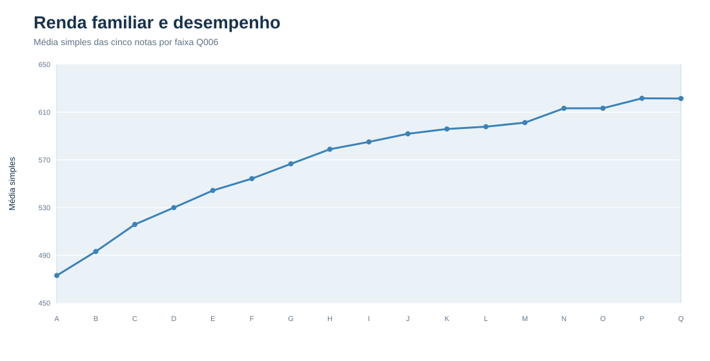
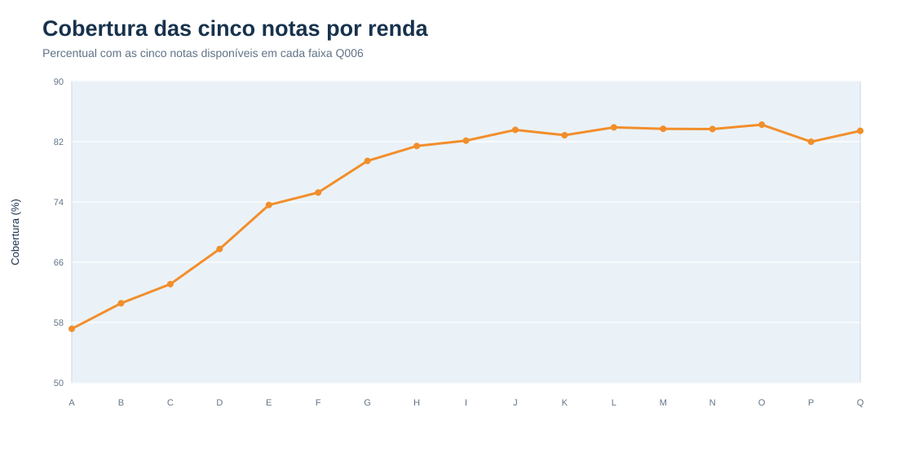
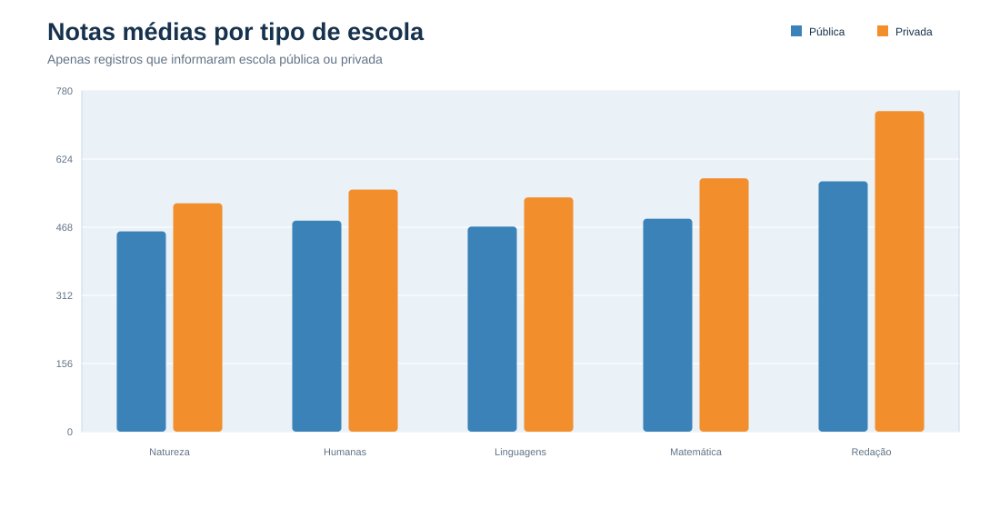
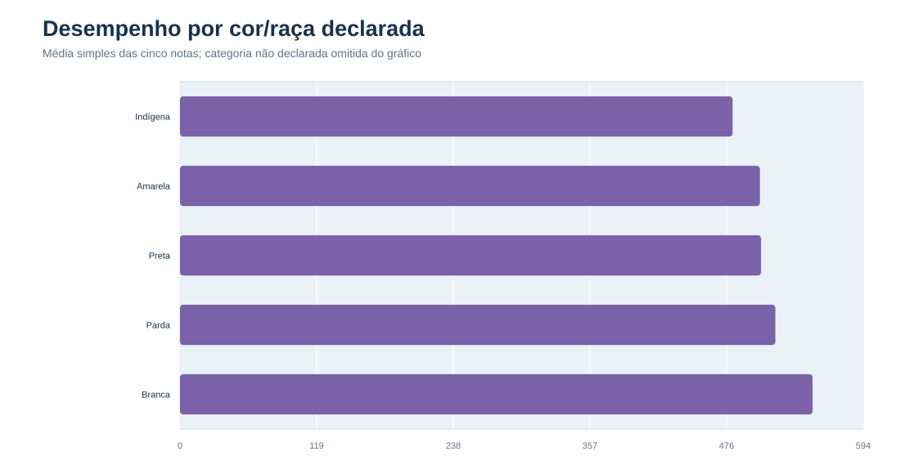
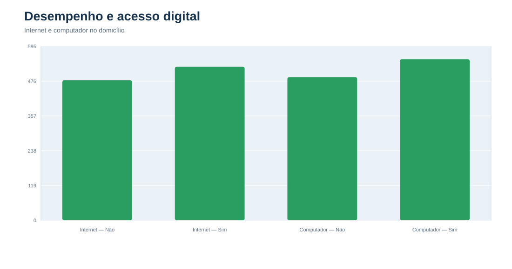
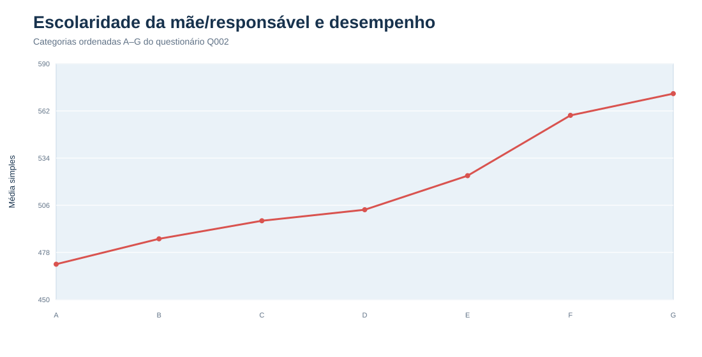
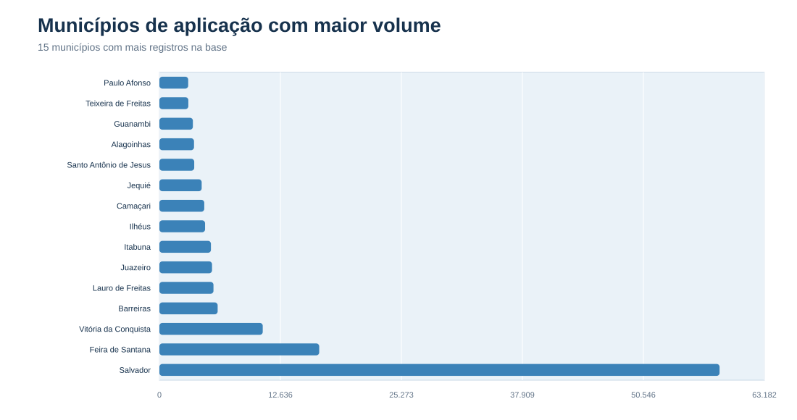

# ENEM 2021 na Bahia — Desempenho, Perfil Socioeconômico e Território com Python

Projeto de portfólio em **Análise de Dados aplicada à Educação e Políticas Públicas**, construído a partir de um recorte dos Microdados do ENEM 2021 para a Bahia e do questionário socioeconômico.

## Pergunta central

**Como a participação e o desempenho dos registros do ENEM 2021 na Bahia variam segundo renda familiar, tipo de escola, cor/raça, escolaridade dos responsáveis, acesso digital e município de aplicação da prova?**

O estudo é **descritivo**. As diferenças observadas não são interpretadas como efeitos causais.

## Base analisada

As duas bases possuem **266.194 registros** e se unem 1:1 por `NU_INSCRICAO`.

- registros na base conjunta: **266.194**
- presença em CH/LC: **69,44%**
- presença em CN/MT: **65,88%**
- registros com as cinco notas disponíveis: **174.793 (65,66%)**
- municípios de aplicação da prova: **162**

> As notas ausentes **não foram imputadas**. A ausência de nota está associada a faltas e eliminações; preencher esses casos pela média ou mediana criaria resultados artificiais.

## Indicador de desempenho

Para comparações sintéticas, foi criada `MEDIA_SIMPLES_5`, a média aritmética de Ciências da Natureza, Ciências Humanas, Linguagens, Matemática e Redação.

**Essa média não é uma nota oficial do ENEM** e não substitui pesos ou critérios utilizados por cursos e instituições.

## 1. Renda familiar e desempenho



Entre os registros com as cinco notas observadas:

- nenhuma renda (`Q006 = A`): média **473,05**
- acima de R$ 22 mil (`Q006 = Q`): média **621,45**
- diferença descritiva entre os extremos: **148,40 pontos**

## 2. Cobertura das cinco notas por renda



A disponibilidade das cinco notas também varia entre grupos:

- nenhuma renda: **57,16%**
- acima de R$ 22 mil: **83,44%**

Esse resultado é metodologicamente importante: as comparações de desempenho são condicionais a quem possui notas observadas.

## 3. Tipo de escola do Ensino Médio



Entre os registros que informam escola pública ou privada:

- média simples — pública: **494,24**
- média simples — privada: **585,34**
- diferença: **91,09 pontos**

Entretanto, **63,46%** da amostra com cinco notas está na categoria `Não respondeu` em `TP_ESCOLA`. Por isso, a comparação pública × privada não representa toda a base.

## 4. Cor/raça declarada



As médias diferem entre os grupos de cor/raça declarados. O projeto apresenta essas diferenças de forma descritiva, sem atribuir à variável racial uma interpretação causal isolada.

## 5. Acesso digital no domicílio



Entre os registros com cinco notas:

- diferença entre **com e sem internet**: **46,57 pontos**
- diferença entre **com e sem computador**: **61,07 pontos**

## 6. Escolaridade da mãe/responsável



A média simples cresce ao longo das categorias ordenadas de escolaridade da mãe/responsável, de `A` (nunca estudou) a `G` (pós-graduação). A categoria `H` (`Não sabe`) é mantida nos agregados, mas não é tratada como nível da escala educacional.

## 7. Municípios de aplicação



O gráfico mostra os municípios **onde a prova foi aplicada**, e não necessariamente o município de residência ou da escola do participante.

Salvador concentra o maior volume de registros, seguido por Feira de Santana e Vitória da Conquista.

## Principais achados

1. A base conjunta possui **266.194 registros**; **174.793** têm as cinco notas disponíveis.
2. A média simples das cinco notas aumenta ao longo das faixas de renda familiar.
3. A própria disponibilidade das cinco notas também aumenta nas faixas de renda mais altas, exigindo cautela com seleção da amostra.
4. Entre quem informou escola pública/privada, a média é maior no grupo de escola privada.
5. Há diferenças descritivas entre grupos de cor/raça declarados.
6. Registros com internet e computador no domicílio apresentam médias superiores entre aqueles com notas observadas.
7. A escolaridade dos responsáveis apresenta gradiente descritivo de desempenho.
8. `NO_MUNICIPIO_PROVA` representa **município de aplicação da prova**, não o território de residência.
9. Nenhuma dessas comparações demonstra causalidade.

## Estrutura do projeto

```text
enem-2021-bahia-analise-socioeconomica/
├── .github/workflows/python-tests.yml
├── data/
│   ├── source/README.md
│   └── processed/
├── docs/revisao_fontes.md
├── notebooks/enem_2021_bahia_analise.ipynb
├── reports/
│   ├── figures/
│   ├── methodology.md
│   └── summary.json
├── src/
├── tests/
├── requirements.txt
└── README.md
```

## Dados-fonte

Os CSVs brutos não são versionados porque a base principal ultrapassa 100 MB.

Para reproduzir a análise integralmente, coloque em `data/source/`:

```text
dados_enem_2021_BA.csv
dados_enem_2021_BA_questoes_socieconomicas.csv
```

Os agregados usados no README estão disponíveis em `data/processed/`.

## Como executar

```bash
python -m venv .venv
pip install -r requirements.txt
python -m src.analysis
python -m src.visualization
pytest -q
```

## Tecnologias

Python · Pandas · NumPy · Matplotlib · Jupyter Notebook · Pytest · GitHub Actions

## Limitações

- recorte restrito à Bahia e ao ENEM 2021;
- análise transversal e descritiva;
- `MEDIA_SIMPLES_5` é um indicador sintético criado no projeto;
- notas ausentes não são imputadas;
- cobertura de notas varia entre grupos socioeconômicos;
- grande proporção de `TP_ESCOLA = Não respondeu`;
- município de prova não equivale a residência;
- não há inferência causal.

## Autor

**Pablo Sena**

GitHub: [@pablosena28](https://github.com/pablosena28)
